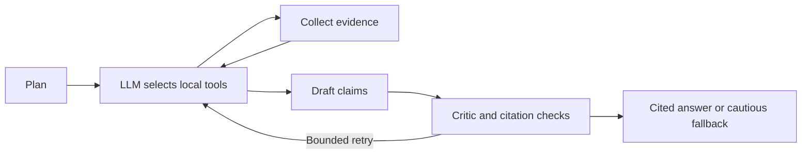

# Pharma Research

A local-corpus pharmacology research assistant for the Syntax Systems GenAI assignment.
It plans compound questions, selects research tools dynamically and returns reviewed claims
with traceable sources through a FastAPI API and responsive browser interface.
**For research and education, not medical advice.**

## Architecture



LangGraph maintains explicit research state. The model chooses `search_documents` and
`read_document_section` with `tool_choice="auto"`; selection is not routed by medication keywords.
FAISS `IndexFlatIP` searches normalized embeddings; BM25 adds lexical matching and RRF fuses ranks.
A separate critic reviews claims and ambiguity; code checks exact quotes and citation validity.
See [architecture and rationale](docs/architecture.md) for module boundaries and design choices.

## Docker

Use the supplied `.env`, or create one from `.env.example` with your own credentials.

```sh
docker build -t agent .
docker run -p 8000:8000 --env-file .env agent
```

Open **http://localhost:8000**. The container includes the corpus/frontend, runs non-root and
listens on `0.0.0.0:8000`. Only the configured model/embedding API is external; port 8000 must be free.
Set `OPENAI_API_KEY` and the proxy URL in `OPENAI_BASE_URL`, preferred over legacy `OPENAI_BASE_UR`.
Defaults are `OPENAI_MODEL=gpt-5.6-terra` and `OPENAI_EMBEDDING_MODEL=text-embedding-3-small`.
Corpus embeddings load from a validated cache or are generated at startup. Searches embed only
queries. Fresh containers rebuild the cache unless a persistent volume is explicitly mounted.

## Local installation

Python 3.11+ is required; validation used Python 3.12. From the repository root:

```powershell
python -m venv .venv
.venv\Scripts\Activate.ps1
python -m pip install -r requirements-lock.txt
python -m uvicorn pharma_agent.api:app --host 0.0.0.0 --port 8000
```

On macOS/Linux, activate with `source .venv/bin/activate` instead. The lock file pins the
compatible runtime dependencies. Keep `.env` untracked and never include credentials in outputs.

## API usage

PowerShell example against a running application:

```powershell
Invoke-RestMethod http://localhost:8000/health
$body = @{question = "What are the main contraindications for warfarin?"} | ConvertTo-Json
Invoke-RestMethod http://localhost:8000/ask -Method Post -ContentType 'application/json' -Body $body
```

`GET /health` returns 200 for liveness; inspect `ready` for index readiness. `POST /ask` returns
an answer, status, citations, sources, plan, workflow summary, metrics and disclaimer. Citations
include source sections, line spans and exact quotes; `/sources/{chunk_id}` returns the passage.
Local API documentation is at `/docs`; the schema is at `/openapi.json`. Invalid input returns
422, unavailable research 503, and timeout 504. Provider error messages are sanitized.

## Testing and evaluation

Install development dependencies and run offline checks:

```sh
python -m pip install -r requirements-dev.txt -c requirements-lock.txt
python -m pytest -q
python -m ruff check pharma_agent scripts tests
python -m ruff format --check pharma_agent scripts tests
python -m pip check
```

Live checks require configured credentials and incur provider usage:

```sh
python -m scripts.preflight
python -m scripts.evaluate --agent --judge --output evaluation/results.json
```

Preflight checks chat, embeddings, automatic tool calls and sanitized provider errors. Evaluation
compares dense/hybrid retrieval and checks answers, citations, latency and calls on the four
public questions plus six additional cases in [evaluation/questions.json](evaluation/questions.json).
The command creates a new `evaluation/results.json`; that raw snapshot is not included in this copy.
[Recorded evaluation results](docs/evaluation.md) preserve the documented baseline and limitations.

For a running Docker application, use the API examples above and inspect the frontend's answer,
source expansion and workflow summary. Preflight and evaluation are the validation scripts
included in this checkout; Docker and browser checks use the API and frontend directly.

## Project layout

`pharma_agent/` contains ingestion, retrieval, tools, the agent, critic, schemas, API and static UI.
`corpus/` contains 20 medication documents and the glossary; `tests/` contains offline tests.
`scripts/` provides preflight and evaluation commands; [AGENTS.md](AGENTS.md) records coding guidance.

## Limitations

The corpus is static; exact citations do not prove correct interpretation. Shared model errors
and research budgets can yield incomplete answers or timeouts. `verified` means source review
passed, not clinical approval. Authentication, per-user quotas and human clinical validation
are outside this demo; broader independent evaluation and deployment controls are required.

## AI assistance

AI assisted implementation, testing, documentation and review. The author remains accountable
for architecture decisions and all submitted code. AGENTS.md is the shareable coding configuration.
Test doubles are isolated from production; semantic evaluation uses automated model grading.
